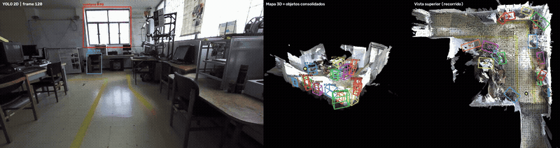
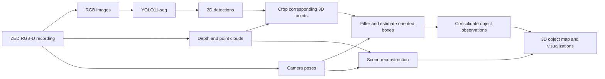
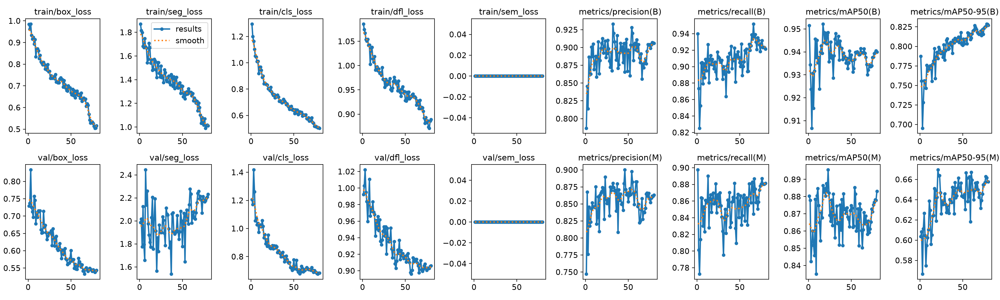
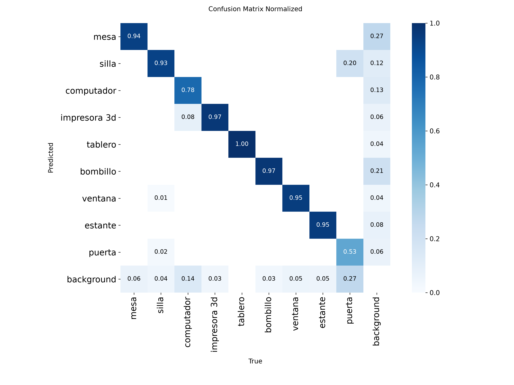

# ZED Semantic 3D Mapping

**Recognizing laboratory objects and placing them in a reconstructed 3D scene.**

An academic team project combining a **ZED 2 stereo camera**, **YOLO11 instance segmentation** and **point-cloud geometry**. Recorded RGB-D sequences are processed offline to reconstruct a laboratory, identify familiar objects and visualize their estimated locations and oriented 3D bounding boxes.

[Español](docs/README.es.md) · [How it works](docs/methodology.md) · [Running the code](docs/reproduction.md) · [Team](AUTHORS.md)

## Watch the project

[](media/demo-final.mp4)

**[▶ Watch the full demonstration — 1 min 35 s](media/demo-final.mp4)**

The demonstration shows three views: object detections in the camera image, the reconstructed scene with consolidated 3D boxes, and a top-down view of the map and camera trajectory. The exported map and consolidated objects provide context for the recorded sequence; they are not a live reconstruction running at the video's playback speed.

| Video | What it shows |
|---|---|
| [Full demonstration](media/demo-final.mp4) | Camera image, 3D object map and top-down trajectory |
| [Detection and mapping](media/demo-mapping.mp4) | A larger two-panel view of detections and the reconstructed scene |
| [Reconstruction walkthrough](media/reconstruction.mp4) | A visual inspection of the reconstructed point cloud |

The animations play inside the README. Select a video link for the full MP4. Videos are encoded as H.264 for browser playback; a standalone [video gallery](docs/videos.html) is also included and can be opened locally after cloning.

## The problem

A point cloud captures the shape of a room but does not identify its contents. This project combines object recognition with stereo depth and camera poses to give the reconstructed scene object-level meaning: **what is present, where it is, and what approximate volume it occupies**.

The scene is a controlled laboratory with nine trained object categories: **table, chair, computer, 3D printer, board, light bulb, window, shelf and door**. The original class names in the code and visualizations are in Spanish.

## What we built

- A preparation and training workflow for a custom YOLO11 segmentation dataset.
- Offline playback and frame extraction from ZED `.svo` / `.svo2` recordings.
- Reconstruction using camera tracking, coordinate transforms and point-cloud accumulation, alongside a ZED Spatial Mapping implementation.
- Detection-guided 3D point-cloud extraction, filtering, plane fitting, clustering and oriented bounding boxes.
- Multiview consolidation of repeated detections into object hypotheses.
- CSV exports, diagnostic figures and videos connecting the camera view to the reconstructed scene.

The published Python scripts preserve the original project implementation. The portfolio packaging adds documentation, selected results, and lighter copies of the existing videos.

## Pipeline



**Implementation detail:** the trained network predicts instance masks, while the archived automatic 3D pipeline uses its **2D bounding boxes** to select depth points. A separate utility supports external masks. The consolidated boxes summarize observations across frames; they do not imply complete reconstruction of every object's hidden surfaces.

## Recorded results

Two training runs of **80 epochs** are preserved. The table reports the **last epoch of each saved CSV**, rather than mixing the best values from different epochs.

| Validation metric | Training 1 | Training 2 |
|---|---:|---:|
| Box mAP@0.50 | 90.73% | 94.00% |
| Box mAP@0.50:0.95 | 65.25% | 82.71% |
| Mask mAP@0.50 | 87.97% | 88.32% |
| Mask mAP@0.50:0.95 | 57.66% | 65.78% |

Training 2 continues from a previously trained checkpoint. The original split contains **275 training images and 68 validation images**, with frames from the same recordings in both partitions. These results describe that validation setup; they are not an independent-session benchmark or a measurement of dimensional accuracy.



The archived mapping example contains **1,434 3D detections across 710 frames with detections**. Its saved consolidation contains **29 object hypotheses**, of which **19** were marked `ok` by the view-count heuristic. These are algorithm outputs, not a ground-truth inventory of the room.

<details>
<summary>View the confusion matrix</summary>



</details>

## Scope and limitations

The project is an **offline research prototype for a controlled scene**. Depth is sensitive to reflective surfaces, glass, illumination, viewing distance and occlusion. Camera tracking can drift, and proximity-based object association can merge or split hypotheses. The model recognizes the trained categories.

Box dimensions are geometric estimates from observed points. No completed reference-measurement table is included, so **no validated dimensional-error percentage is claimed**. The playback rate of the videos is not a processing-speed benchmark.

## Repository structure

```text
geometry/           Original capture, reconstruction and 3D processing scripts
training/           Original preparation/training scripts and dataset configuration
models/             Trained PT/ONNX model and class metadata
results/            Saved training metrics and selected mapping CSV outputs
media/              Demonstration videos, animated previews and scene images
docs/               Methodology, execution guide, Spanish overview and video gallery
AUTHORS.md          Credits for the three project authors
```

## Explore or run

To understand the project, start with the videos and [methodology](docs/methodology.md). To process your own ZED recordings, follow the [execution guide](docs/reproduction.md), which distinguishes the hardware-independent CSV stage from the ZED/GPU-dependent stages.

Raw recordings, the complete annotation dataset and large point clouds are not included in this compact portfolio repository. The existing results can be inspected without them; full reconstruction and retraining require those inputs.

## Team and acknowledgments

Developed collaboratively by **Andres Camilo Torres Cajamarca**, **Juan Camilo Gómez Robayo**, and **Juan Andrés Vallejo Rozo** as an academic project at **Universidad Nacional de Colombia**. All three are credited as project authors; repository maintenance under Juan Andrés's account does not imply sole authorship.

The project builds on [Stereolabs ZED SDK](https://www.stereolabs.com/en/developers), [Ultralytics YOLO](https://github.com/ultralytics/ultralytics), [Open3D](https://www.open3d.org/) and OpenCV. A conceptual reference is Lahoud and Ghanem, [*2D-Driven 3D Object Detection in RGB-D Images*, ICCV 2017](https://openaccess.thecvf.com/content_iccv_2017/html/Lahoud_2D-Driven_3D_Object_ICCV_2017_paper.html).
