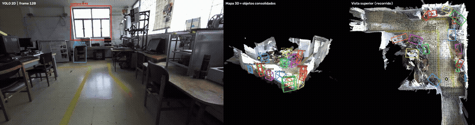

# Mapeo semántico 3D con ZED

**Reconocimiento de objetos de laboratorio y ubicación de sus cajas 3D en una escena reconstruida.**

[English](../README.md) · [Metodología](methodology.md) · [Guía de ejecución](reproduction.md) · [Autores](../AUTHORS.md)

Proyecto académico realizado en equipo por **Andres Camilo Torres Cajamarca, Juan Camilo Gómez Robayo y Juan Andrés Vallejo Rozo**, en la Universidad Nacional de Colombia.

## Demostración

**[▶ Ver el vídeo completo — 1 min 35 s](../media/demo-final.mp4)**

El vídeo muestra la imagen de cámara con detecciones, el mapa reconstruido con cajas 3D consolidadas y una vista superior del recorrido. El mapa y las cajas consolidadas son resultados del procesamiento offline; la velocidad del vídeo no representa el rendimiento de cálculo del sistema.

También puedes ver la [demostración de dos paneles](../media/demo-mapping.mp4), el [recorrido por la reconstrucción](../media/reconstruction.mp4) o abrir la [galería de vídeos](videos.html) localmente después de descargar el repositorio.

## Qué hicimos

Una nube de puntos representa la geometría de un lugar, pero no identifica sus objetos. El proyecto une el reconocimiento visual con la profundidad estéreo y la posición de la cámara para representar objetos reconocidos dentro del mapa de un laboratorio.

1. Registramos secuencias con una cámara estéreo **ZED 2**.
2. Preparamos imágenes y anotaciones para entrenar **YOLO11 de segmentación** con nueve clases propias.
3. Procesamos las grabaciones y las poses de cámara para reconstruir la escena.
4. Asociamos las detecciones 2D con puntos 3D y aplicamos limpieza de nube, ajuste de planos y agrupamiento.
5. Estimamos cajas orientadas y consolidamos observaciones de varios frames.
6. Exportamos resultados a CSV y generamos vistas del mapa y vídeos de demostración.

Las clases entrenadas son **mesa, silla, computador, impresora 3D, tablero, bombillo, ventana, estante y puerta**. El flujo automático archivado recorta puntos mediante las cajas 2D del detector; existe también una utilidad de recorte con máscara externa.

## Resultados registrados

Se conservan dos entrenamientos de 80 épocas. Los siguientes valores corresponden a la última época de cada CSV:

| Métrica de validación | Entrenamiento 1 | Entrenamiento 2 |
|---|---:|---:|
| mAP50 de cajas | 90,73 % | 94,00 % |
| mAP50–95 de cajas | 65,25 % | 82,71 % |
| mAP50 de máscaras | 87,97 % | 88,32 % |
| mAP50–95 de máscaras | 57,66 % | 65,78 % |

El segundo entrenamiento parte de un modelo previamente entrenado. La partición original tiene 275 imágenes de entrenamiento y 68 de validación, con frames de las mismas grabaciones en ambos conjuntos. Las cifras describen esa evaluación; no constituyen una prueba con sesiones independientes ni miden exactitud dimensional.

El ejemplo archivado de mapeo contiene 1.434 detecciones 3D en 710 frames con detecciones. Su consolidado guardado tiene 29 hipótesis de objetos; 19 están marcadas como `ok` según la regla de número de vistas. Estas etiquetas son decisiones del algoritmo.

## Alcance

El resultado es un prototipo de percepción y mapeo **offline**, para un entorno controlado. La profundidad puede degradarse con vidrios, reflejos, iluminación y oclusiones; el seguimiento puede acumular deriva y la asociación puede fusionar o separar hipótesis de objetos. Las dimensiones son estimaciones geométricas y no se presenta un porcentaje de error dimensional validado.

## Contenido del repositorio

- `geometry/`: código original de captura, reconstrucción y geometría.
- `training/`: código original de preparación y entrenamiento.
- `models/`: modelo entrenado PT, exportación ONNX y clases.
- `results/`: curvas, métricas y CSV seleccionados.
- `media/`: vídeos, vistas previas e imágenes del resultado.
- `docs/`: explicación del método, instrucciones y galería.

Se conserva el código Python del proyecto. Esta publicación organiza el material y añade documentación y copias ligeras de los vídeos. Las grabaciones SVO, el dataset completo y las nubes grandes no forman parte de esta versión compacta.
